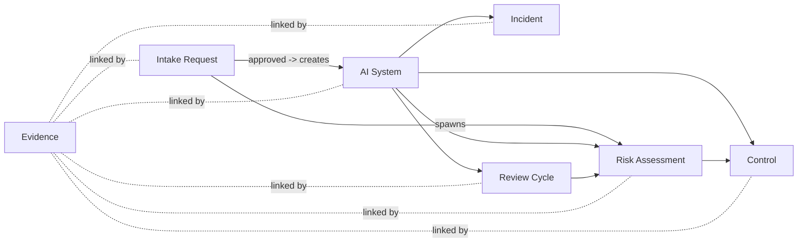

# Exercise 04 — GRC Platform Analyst Tour — Reference Solution

## 1. Solution overview

A governance analyst's day-to-day tooling is almost always a GRC (Governance,
Risk, Compliance) platform — ServiceNow IRM, Archer, OneTrust, LogicGate,
AuditBoard, and similar — extended with an AI-specific object model. The
platform matters less than the **object model** and the **workflow states** the
analyst drives through it. This solution is therefore platform-agnostic: it
describes the objects, forms, workflows, links, and roles that any competent
GRC tool can be configured to express.

The reference answer provides:

- A conceptual object model for AI governance (AI System, Intake Request, Risk
  Assessment, Control, Evidence, Incident, Review Cycle) with fields and
  relationships, presented as a table plus a Mermaid diagram.
- A step-by-step "day-in-the-life" tour, following one intake from arrival to
  inventory publication and review cadence, naming the object actions taken at
  each step.
- A read / write role matrix for Analyst, Engineering owner, Risk owner,
  Legal / Privacy, and Internal audit.
- Decision rationale explaining why Intake Request is separate from AI System,
  why Evidence is its own object, and why Review Cycle is first-class rather
  than a date column.
- Platform-selection factors — the capabilities that make a GRC tool fit for
  this work — stated as questions the analyst should answer during tool
  evaluation, not as vendor recommendations.

VeriSwarm is mentioned once in section 2.6 as a practitioner implementation
example of a purpose-built AI-governance tool; it is **not** a standard and is
not part of the reference model.

## 2. Worked answer or implementation

### 2.1 Object model — tables and diagram

Seven first-class objects cover the end-to-end lifecycle from intake to
monitoring. Each row below lists the object, its high-level fields, and which
other objects it links to.

| Object | High-level fields | Links to |
| --- | --- | --- |
| **AI System** | System ID, name, owner (Engineering), business owner, tier (1–4), lifecycle stage, purpose statement, modality (predictive / generative / agentic), data categories, jurisdictions, status (in development / in production / retired), last review date, next review date. | Intake Request (origin), Risk Assessment (1..n), Control (n..n), Evidence (n..n), Incident (0..n), Review Cycle (1..n). |
| **Intake Request** | Request ID, submitter, requested use case, proposed data inputs, external-model flag, EU-AI-Act-use-category hint, GenAI flag, submission date, triage decision, triage rationale, assigned analyst, resulting AI System ID (nullable until approved). | AI System (0..1 on approval), Risk Assessment (spawns), Evidence (initial links: use case memo, draft model card). |
| **Risk Assessment** | Assessment ID, scope (AI System ID), framework (NIST AI RMF function/category, ISO 42001 clause, EU AI Act article), identified risks, inherent score, residual score, treatment decision, assessor, review date. | AI System (parent), Control (n..n), Evidence (n..n), Review Cycle (triggers next). |
| **Control** | Control ID, control family (e.g., access, monitoring, human oversight, data governance), description, owner, operating frequency, test procedure, last-tested date, status (effective / deficient / not-tested). | AI System (n..n), Risk Assessment (n..n), Evidence (n..n, as test results). |
| **Evidence** | Evidence ID, type (DPIA, model card, eval report, red-team report, bias audit, approval memo, test screenshot), source system, author, created-on, expires-on, hash or version, retention class. | AI System, Risk Assessment, Control, Incident (any of; always linked, never duplicated). |
| **Incident** | Incident ID, affected AI System, detected-on, category (hallucination, bias, privacy, security, availability, misuse), severity, status, root cause, corrective action, closure evidence. | AI System (parent), Evidence (n..n), Risk Assessment (may trigger re-assessment). |
| **Review Cycle** | Cycle ID, scope (AI System ID), cadence (e.g., annual, semi-annual, post-incident, post-model-change), next due date, owner, status (scheduled / in progress / closed), outcome. | AI System (parent), Risk Assessment (0..1 per cycle), Evidence (n..n as cycle artefacts). |

A minimal entity diagram:

The dotted lines are the key design point: Evidence is not owned by any one
parent — it is a shared object that multiple governance records reference.

### 2.2 Day-in-the-life tour

The scenario: the analyst arrives on Monday to a queue of three new intake
requests. The following subsections follow one of them — an internal "support
ticket summariser" using an external GenAI model — through the platform.

#### Step 1 — Receive and validate the Intake Request

The analyst opens the new **Intake Request** record. The submitter (a product
manager) has filled in use case, proposed data inputs, and flagged
external-model = yes. The analyst's first job is **field validation**, not risk
scoring:

- Required fields populated (submitter, use case, data categories,
  external-model flag, jurisdictions).
- Use-case text is specific enough to classify — vague strings like "AI for
  productivity" get bounced back.
- Attachments: a draft one-pager is linked as initial **Evidence** (type:
  _use case memo_).

Action taken on the object: set `status = validated`, assign analyst, record
validation timestamp. The intake record is **not yet** promoted to an AI System.

#### Step 2 — Trigger the tier-triage workflow

The analyst runs the tier-triage workflow. In most GRC platforms this is a
decision-table or scripted flow that reads Intake Request fields and proposes a
tier (1 = highest risk, 4 = lowest). Inputs include: data sensitivity,
affected-population scope, decision autonomy, external-model usage, and any EU
AI Act use-category hint supplied by the submitter.

The workflow writes a proposed tier plus a human-readable rationale back to the
Intake Request. The analyst reviews, adjusts if needed (with a comment
explaining the adjustment), and sets `triage_decision = Tier 2`,
`triage_rationale = "External GenAI model on internal support data; moderate
operational impact; not a Prohibited or High-Risk EU AI Act category"`.

Action taken on the object: write triage fields on Intake Request; move status
to `triaged`. The workflow state and the analyst identity are stamped with a
timestamp — this is the audit trail the internal auditor will later verify.

#### Step 3 — Spawn the Risk Assessment task

With a tier assigned, the workflow spawns a **Risk Assessment** record linked
back to the Intake Request. The assessment template is pre-populated from the
tier: Tier 2 requires NIST AI RMF Map and Measure coverage, an ISO/IEC 42001
clause 6 risk-opportunity note, and — because an external model is in play —
third-party supply-chain items under RMF Govern 6.

The analyst **assigns** the assessment to the risk owner (not to themselves).
The analyst's role here is to orchestrate and link; the risk owner and the
engineering owner co-author the content. The analyst sets a due date, chosen
from the tier's SLA (e.g., Tier 2 = 10 business days).

#### Step 4 — Link evidence (DPIA, model card, eval report)

As the assessment proceeds, three artefacts are produced outside the GRC tool:

- A **DPIA** by Legal / Privacy (in the privacy-office system of record).
- A **model card** by the engineering owner (in the model registry).
- An **eval report** covering accuracy, bias, and prompt-injection resistance
  (from the evaluation pipeline).

The analyst does **not** copy these documents into the GRC platform. Instead,
each document is registered once as an **Evidence** object (with source
system, author, created-on, hash or version) and then **linked** from the Risk
Assessment, the relevant Controls, and — once the AI System record exists —
the AI System itself. One evidence object, many links.

#### Step 5 — Promote the Intake Request to an AI System record

When the Risk Assessment is signed off (risk owner approves; Legal / Privacy
co-signs for the DPIA; any required council review is logged as evidence), the
Intake Request workflow transitions to `approved`. This transition creates
the **AI System** record and copies the system-identifying fields across
(name, owner, tier, modality, jurisdictions). The Intake Request is **not**
deleted — it becomes the historical record of how this system entered the
inventory, and remains linked to the AI System forever.

The analyst now sets AI System `status = in development` (or `in production`
if already live), confirms inherited Evidence links, and attaches the baseline
**Controls** chosen from the Tier-2 control set (human-in-the-loop review,
prompt-injection monitoring, output-logging retention, supplier change notice,
etc.).

#### Step 6 — Set the Review Cycle

The analyst creates the first **Review Cycle** record for this AI System. For
Tier 2, cadence might be "annual plus post-material-change" — expressed as two
fields: `cadence = annual`, `trigger_events = [model version change, supplier
change, incident severity >= medium]`. The platform schedules the next-due date
and will later auto-create a new Review Cycle record when the cadence fires.

Review Cycle is a first-class object (not a date column on AI System) because:

- It needs its own status, owner, outcome, and evidence links.
- Multiple cycles can run concurrently (e.g., an ad-hoc post-incident review
  on top of the annual cadence).
- History of past reviews is auditable as its own record set.

#### Step 7 — Attach to downstream queues

Finally, the analyst routes the AI System record into the appropriate
downstream queues:

- **AI governance council**: added to the next council agenda queue; agenda
  link stored as evidence.
- **Internal audit**: the record becomes visible in the audit inventory view;
  internal auditors subscribe to Review Cycle status changes.
- **Inventory export**: the AI System record is included in the next scheduled
  inventory export (API-driven, so external reporting systems — regulatory
  disclosures, enterprise risk dashboards — pick it up automatically).

End-of-day state: Intake Request `closed-approved`, AI System `in production`,
Risk Assessment `signed-off`, Controls `assigned`, Evidence `linked`, Review
Cycle `scheduled`, inventory `published`. Every state change carries a
timestamp and an actor.

### 2.3 Role matrix — who reads vs writes which objects

R = read, W = write, A = approve (sign-off state). Blank = no routine access.

| Object | Analyst | Engineering owner | Risk owner | Legal / Privacy | Internal audit |
| --- | --- | --- | --- | --- | --- |
| Intake Request | W (validate, triage, link) | W (submit, update tech fields) | R, A (tier confirm for Tier 1/2) | R | R |
| AI System | W (metadata, status, links) | W (technical fields, lifecycle stage) | R, A (on material change) | R | R |
| Risk Assessment | W (orchestrate, link evidence) | W (contributes content) | W, A | W (privacy sections), A (DPIA sign-off) | R |
| Control | W (assign, link) | W (operate, test, update status) | R, A (effectiveness sign-off) | R | R (audit tests separately) |
| Evidence | R + **link only** | W (create via source system) | R | W (DPIA, legal memos) | R |
| Incident | W (log, triage, link evidence) | W (root cause, corrective action) | R, A (closure for high-severity) | R, A (if privacy/legal impact) | R |
| Review Cycle | W (schedule, orchestrate) | R, W (provide inputs) | W, A | R | R, A (audit outcomes periodically) |

The critical row is **Evidence**: the analyst's permission is *read + link only*,
not write. See decision rationale below.

### 2.4 Decision rationale

- **Intake Request is separate from AI System.** Intake is a *request to enter
  the inventory*. Many requests are rejected, withdrawn, or merged with existing
  systems; most never become AI Systems. Collapsing them into one table
  pollutes the inventory with provisional rows and loses the historical "how
  did this system get approved?" trail. Keeping Intake Request separate also
  lets intake SLAs, tier-triage, and submitter-facing forms evolve
  independently of the production inventory schema.

- **Evidence is its own object, not an attachment on another record.** A single
  DPIA often covers multiple AI Systems; a single model card is referenced by
  the Risk Assessment, several Controls, and the Review Cycle. If evidence
  lived as an attachment on one parent, the same document would be duplicated
  (with divergent versions) across records — the opposite of what auditors
  want. Making Evidence a first-class object with stable identity, source
  system, hash/version, and retention class means **one artefact, many links**,
  and it enables retention policy to be enforced per evidence class rather than
  per parent record.

- **Review Cycle is first-class, not a date column.** A `next_review_date`
  column cannot express concurrent reviews, outcome, assigned owner, or history
  of past reviews. It also cannot be queried for "which reviews are overdue by
  owner" without ambiguity. Making Review Cycle an object gives the analyst a
  queue to work from and the auditor a record set to sample from.

- **Analyst does not write to Evidence.** Evidence is produced by subject-matter
  owners (engineering produces the model card; privacy produces the DPIA;
  evaluation pipelines produce eval reports). If the analyst could edit
  evidence content, the chain of custody breaks and the analyst becomes both
  producer and reviewer of the same artefact. The analyst *links* evidence into
  the governance graph; the originating owners write it.

- **Workflow states carry timestamps and actors.** Every state transition
  (validated → triaged → in-assessment → approved / rejected) must be stamped
  with when and by whom. This is the single most important audit property and
  is a hard requirement when evaluating a candidate platform.

### 2.5 Platform-selection factors

When evaluating a GRC platform to carry this object model, the analyst should
answer yes to each of the following before committing:

| Factor | Why it matters | How to verify during evaluation |
| --- | --- | --- |
| Custom objects with typed relationships | Required to model AI System ↔ Evidence ↔ Control as n..n without hacks. | Build a two-object link in the sandbox; confirm referential integrity. |
| Workflow engine with named states + timestamps + actor on every transition | Audit trail requirement. | Export transition history for one record; confirm all fields present. |
| Structured evidence linking (not just file attachments) | Lets one evidence record be referenced from many parents with version/hash. | Create one evidence record; link from two parents; change evidence version and confirm both parents see the update. |
| Role-based permissions down to the object + action level | Needed to enforce "analyst can link but not write Evidence". | Configure a role; attempt a disallowed action; confirm denial is logged. |
| API for inventory export | Downstream regulatory and enterprise reporting consume the inventory — manual export does not scale. | Call the inventory-export endpoint; confirm fields, pagination, and auth model. |
| Scheduled recurring records (for Review Cycle) | A review cadence must create new cycle records automatically, not just send reminders. | Configure an annual cadence with a 1-minute test interval; confirm new records appear. |
| Reporting / dashboarding over the object graph | Needed for the analyst's own queue and for leadership views. | Build an "overdue reviews by owner" view without SQL exports. |

These are tool-capability questions, not vendor names. Any platform that
satisfies them can carry the model. A dedicated AI-governance product such as
**VeriSwarm** is one *practitioner implementation example* of a system built
specifically around objects like AI System and Evidence rather than retrofitting
generic GRC records — it is useful as a reference point, but it is **not a
standard** and the reference model above does not depend on it.

## 3. Validation steps

A reviewer can confirm the solution is correct by executing the following
checks against the configured platform.

1. **Object count and separation.** Seven first-class objects exist: AI System,
   Intake Request, Risk Assessment, Control, Evidence, Incident, Review Cycle.
   None is a mere column on another.
2. **Intake-to-system promotion is non-destructive.** Approve one Intake
   Request; confirm an AI System record is created *and* the Intake Request
   persists, linked to the new AI System.
3. **Evidence reuse works.** Create one Evidence record. Link it from a Risk
   Assessment and a Control. Change the evidence version. Both parents reflect
   the new version without duplicate records.
4. **Analyst cannot write Evidence content.** Log in as the analyst role; try
   to edit an Evidence body field. The platform denies the action and logs the
   denial.
5. **Review Cycle fires automatically.** Configure a cadence on an AI System;
   advance the system clock (or wait for the test interval); confirm a new
   Review Cycle record is created with correct linkage and status
   `scheduled`.
6. **Transition audit trail is complete.** Export the state history for one
   Intake Request from `received` to `closed-approved`; confirm each
   transition has timestamp, actor, and from/to state.
7. **Role matrix enforced.** For each role in section 2.3, run one disallowed
   action and one allowed action; confirm the platform's enforcement matches
   the table.
8. **Inventory export endpoint is callable.** Pull the AI inventory via the
   API; confirm it returns at least: system ID, name, tier, owner, status,
   jurisdictions, last review date, next review date, and linked evidence
   count.

## 4. Rubric or review checklist

Score each criterion out of 3; a passing design averages ≥ 2.0 with no 0s on
the first five rows.

| Criterion | 3 — strong | 2 — acceptable | 1 — weak | 0 — fail |
| --- | --- | --- | --- | --- |
| **Separation of concerns in the object model** | Seven objects, each with distinct fields and purpose; relationships typed. | Six to seven objects; one borderline collapse (e.g., Review Cycle fields on AI System) but documented. | Fewer than six objects; two concerns conflated. | Inventory modelled as one flat table / spreadsheet. |
| **Presence of a Review Cycle** | First-class object with cadence, owner, status, outcome, and automated scheduling. | First-class object but without automated scheduling. | Date column only. | No review cadence at all. |
| **Explicit evidence links** | Evidence is a shared first-class object; one record, many links; versioned. | First-class Evidence but duplication tolerated. | Evidence as attachments only. | Evidence embedded as free text in assessment records. |
| **Role separation** | Analyst, Engineering, Risk, Legal/Privacy, Internal audit each have distinct read/write/approve rights; Analyst cannot write Evidence content. | Minor permission overlaps but intent clear. | Two of three key separations absent. | Single role with all rights. |
| **Workflow states auditable with timestamps and actor** | Every transition on every object stamped; exportable history. | Timestamps on key objects only. | Timestamps but no actor. | No audit trail. |
| Platform-agnostic framing | Model stated in terms of objects and capabilities, not a specific vendor. | Minor vendor-specific terms. | Reads as a single-vendor configuration guide. | Recommends a specific vendor as required. |
| Decision rationale documented | All three (Intake vs AI System; Evidence shared; Review Cycle first-class) covered in writing. | Two of three documented. | One covered. | None. |

Binary checks (all must pass):

- [ ] Intake Request and AI System are separate objects, linked by promotion.
- [ ] Evidence is a shared object, not an attachment field.
- [ ] Review Cycle is a first-class object with its own owner and status.
- [ ] Analyst role has `link` but not `write` on Evidence content.
- [ ] Every workflow state transition is timestamped with an actor.
- [ ] An inventory-export API exists and returns at least the fields listed in
      validation step 8.

## 5. Common mistakes

- **Treating the inventory as a spreadsheet.** A flat row-per-system
  "inventory tracker" (even a sophisticated one) cannot express n..n evidence
  reuse, parallel reviews, or audit history. The moment there is a second AI
  System sharing a DPIA, the spreadsheet model collapses.
- **Letting analysts write to Evidence objects.** Analysts orchestrate and
  link; owners author. When analysts edit evidence content, chain of custody
  breaks and the same person is both producer and reviewer. The permission must
  be *link-only*.
- **Missing or implicit review cadence.** A `next_review_date` column is not a
  review cadence — it is a reminder. A cadence requires its own object so
  reviews can be queued, assigned, completed, and re-opened without losing
  history. Without one, inventory rows silently go stale.
- **Conflating the Risk Assessment with the inventory row.** When the AI
  System row has columns like `residual_risk_score`, the row is doing two
  jobs — descriptive inventory and risk record — and will drift as the system
  changes. Keep risk fields on the Risk Assessment, link to the AI System.
- **Letting Intake Request close without a recorded tier decision.** The tier
  is the handoff between intake and the rest of governance; if intake can close
  without it, downstream workflows cannot route the record. Make tier a
  required field for the `approved` transition.
- **No API for export.** Regulatory disclosures (EU AI Act Article 72
  post-market monitoring, internal audit sampling, enterprise risk reporting)
  all need programmatic reads of the inventory. A tool without an inventory
  API will eventually be worked around with manual exports — and the manual
  exports will diverge from the system of record.

## 6. References

- ISO/IEC 42001:2023, _Information technology — Artificial intelligence —
  Management system_. Clause 7 covers **documented information** (relevant to
  Evidence as a first-class object, retention, and version control); clause 9
  covers **performance evaluation and internal audit** (relevant to Review
  Cycle, internal-audit read access, and transition history).
  <https://www.iso.org/standard/81230.html>
- NIST, _AI Risk Management Framework (AI RMF 1.0)_, January 2023. **Govern 1**
  (policies, processes, procedures) grounds the intake and tier-triage
  workflow; **Govern 4** (culture and communication) grounds the routing of AI
  System records to the governance council and audit queues.
  <https://www.nist.gov/itl/ai-risk-management-framework>
- NIST, _AI RMF Playbook_ — expanded suggested actions per category; used to
  validate the control families named in section 2.2 step 5.
  <https://www.nist.gov/itl/ai-risk-management-framework>
- EU AI Act, Regulation (EU) 2024/1689. **Article 72** on **post-market
  monitoring** by providers of high-risk AI systems grounds the Review Cycle
  object and the requirement for an inventory-export API feeding monitoring
  reports. <https://eur-lex.europa.eu/eli/reg/2024/1689/oj>
- VeriSwarm — mentioned once in section 2.5 as a **practitioner implementation
  example** of a purpose-built AI-governance tool, not as a standard. The
  reference model in this solution does not depend on it.
